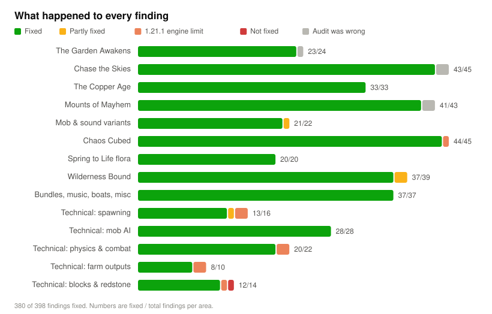
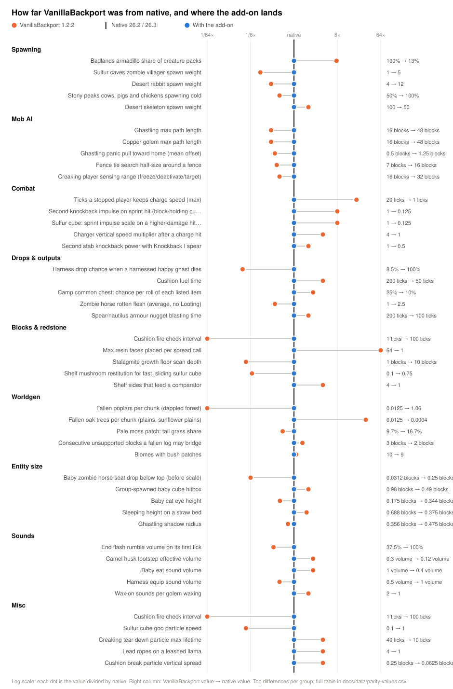
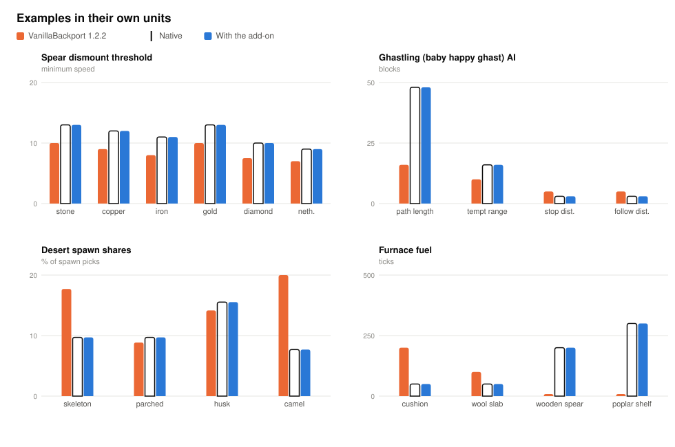

# VanillaBackport Parity

An add-on for **[VanillaBackport](https://modrinth.com/mod/vanillabackport) 1.2.2** on **NeoForge 1.21.1**. It makes
every backported feature behave exactly the way it does in current vanilla Minecraft: the same numbers, the same rules,
the same random rolls, and the same spawning. A mob farm, sorter, breeder or redstone build designed in the newest
version works the same way here.

The reference is **Minecraft 26.2**. The Wilderness Bound content (poplar, dappled forest, shelf mushroom, straw bed,
cushion, abandoned camps) isn't in 26.2, so it is compared with **26.3-pre-1** instead.

<picture>
  <source media="(prefers-color-scheme: dark)" srcset="docs/charts/status-dark.svg">
  
</picture>

## Requirements

- Minecraft 1.21.1 with NeoForge 21.1.200 or newer
- **VanillaBackport exactly 1.2.2** (every patch targets that build)
- Platform 1.4.2 (VanillaBackport's library)

Install the jar on both the server and the clients. VanillaBackport's config options are respected: a fix never turns
back on a feature you turned off.

## What was compared

VanillaBackport 1.2.2 and its Platform library were decompiled and compared line by line with the decompiled Minecraft
26.2 and 26.3-pre-1 clients and their data. Vanilla 1.21.1 was used to tell VanillaBackport's choices apart from
engine differences. The comparison covered every class (constants, conditions, random-call order, tick timing) and every
data and asset file.

It ran three times:

1. **Feature by feature**, for all nine feature groups.
2. **A second look** at every class nobody had named yet, every partial fix, and every fix already made.
3. **Mechanic by mechanic**, across all features, where farms are sensitive. That covers spawning, mob AI, physics
   and combat, drops and farm outputs, and blocks and redstone.

That produced **398 findings**:

| | |
|---|---|
| Fixed | 380 |
| Partly fixed | 4 |
| Not possible on the 1.21.1 engine | 8 |
| Not fixed | 1 |
| The finding turned out to be wrong | 5 |

### How far off VanillaBackport was

Each row is one measured value, shown as a multiple of the native value. Native sits at the centre line. Orange is
VanillaBackport 1.2.2 and blue is with this add-on.

<picture>
  <source media="(prefers-color-scheme: dark)" srcset="docs/charts/ratios-dark.svg">
  
</picture>

<picture>
  <source media="(prefers-color-scheme: dark)" srcset="docs/charts/examples-dark.svg">
  
</picture>

All 336 measured values (VanillaBackport, native and add-on, with the finding each one comes from) are in
[`docs/data/parity-values.csv`](docs/data/parity-values.csv). The per-area totals are in
[`docs/data/parity-summary.csv`](docs/data/parity-summary.csv). Every finding, with the code quoted from both sides, is
in [`docs/audit/`](docs/audit).

### Some of what changes

- **Spawning:**
  - Native biome spawn weights and list order. For example, deserts now give one skeleton per parched, as native does,
    instead of two, and camels are no longer 2.6× too common.
  - Farm animals spawn in badlands again.
  - Leashed zombie horses, camel husks and nautiluses no longer despawn.
  - Natural nautilus and camel-husk jockeys actually spawn.
- **The Garden Awakens:**
  - A creaking hit makes 2–3 resin clumps, not dozens.
  - Creakings sense players up to 32 blocks away, not 16.
  - Native pale garden placement.
- **Chase the Skies:**
  - A happy ghast always drops its harness (VanillaBackport: 8.5% of the time).
  - Native ghastling pathing and tempt ranges.
  - Native leash knots and lead physics, with the new lead sounds.
- **The Copper Age:**
  - Plain lightning rods attract lightning again.
  - Copper golems path up to 48 blocks.
  - Chests close properly after a golem visit.
  - Copper armour has its native share of mob spawns.
  - Waxed rods don't stop nearby copper from oxidising.
- **Mounts of Mayhem:**
  - Spears use the native `spear` damage type, so there's no double knockback.
  - Native dismount thresholds for every tier.
  - Nautiluses can be tempted.
  - Zombies spawn with iron spears.
- **Chaos Cubed:**
  - Native sulfur cube knockback, splitting and bouncing.
  - Sulfur spikes grow to 3 blocks, not 7.
  - Geysers launch players smoothly on their own client.
  - Sulfur caves appear in Large Biomes and Amplified worlds.
- **Spring to Life and Wilderness Bound:**
  - Fallen trees, leaf litter and cactus flowers are placed the native way.
  - Native feature order and decoration seeds.
  - Dappled forest placement no longer flips between runs.
  - Abandoned camp templates match native.
- **Mob variants:**
  - Native baby models, hitboxes and textures.
  - All sound variants.
  - Exact biome lists.
  - Datapack variants now reach clients on dedicated servers.
- **Everything else:**
  - Hold-to-empty bundles, the locator bar, music timing and fades, End flashes and End lighting, and the
    cloud distance option.
  - Native creative-tab order and recipe-book unlocks.
  - Native translations in all 142 languages.

## Testing

- **302 GameTests**, all passing on a dedicated server with VanillaBackport 1.2.2 and this add-on. Each group of tests
  was also run with its fixes switched off, and every test of a fix fails there. So the tests catch VanillaBackport's
  old behaviour, not just the new one; only a few deliberate control tests pass either way.
- **A client check** applies every mixin, client ones included, then loads a world with every backported mob (adult and
  baby) and block. It finishes without errors. Every mixin is `required`, so a target that no longer matches stops the
  game at startup instead of failing silently.

## Known differences from native

These can't be matched on the 1.21.1 engine without changing vanilla behaviour for everything else:

- **Wandering trader:** 1.21.1 offers 6 trades from fixed pools; 26.2 offers 9 from per-world random sequences.
- **Wolves:** wolves don't eat fish or rabbit stew, a vanilla change from 26.x.
- **Mob spawning:**
  - 1.21.1 re-checks the global mob cap at each chunk.
  - Animals still appear in new chunks when `doMobSpawning` is off.
  - Villagers that turn into zombie villagers can still arrive wearing armour.
- **No `tntExplodes` gamerule:** adding one would change vanilla TNT too.
- **Lunge enchantment:** its grace time after the dash only reaches players.
- **Huge mushrooms** can overwrite resin clumps.
- **Composting:** Wilderness Bound items roll their composter chance a different way, with the same odds.
- **Dispenser shears** on a leashed sulfur cube cut the lead first.
- **Witch-hut cats:** native's random-colour witch-hut cats come from a vanilla bug that NeoForge fixes. NeoForge's fix
  is kept.
- **Camp and secret maps** use the native names and icons, but they are filled maps, not separate map items.
- **Copper golem statues** send one extra comparator update when their pose changes. No build can detect it.

Some visual details (sounds, particles, rendering offsets) are only checked against the code, not compared on screen.

## Notes for packs and worlds

- **Worldgen changes affect newly generated chunks only.** That covers biome placement, features, structures and
  surface rules. Existing terrain is untouched.
- **Peaceful follows the native rule for every monster**, including other mods' monsters.
- **The iron golem's flower gift** uses the native goal, which also counts copper golems.
- **Tag overrides add or remove single entries** wherever that gives the native result, so other mods' tag additions
  are kept.

## Building

```sh
./gradlew build
```

Use JDK 21. Put `VanillaBackport-neoforge-1.21.1-1.2.2.jar` and `Platform-neoforge-1.21.1-1.4.2.jar` in `libs/` first.
`./gradlew runGameTestServer` runs the tests. The scripts in `tools/` regenerate the shared data, worldgen,
translations and charts from the decompiled reference trees; see [`tools/README.md`](tools/README.md).

## Credits and license

VanillaBackport and Platform are by BlackGear; this add-on only patches them and needs both. Minecraft and its assets
are Mojang's. The jar includes some of Mojang's sounds, textures, models and structure templates from 26.2 and
26.3-pre-1, the same way VanillaBackport does; those files are not covered by this project's license.

This project isn't affiliated with or endorsed by Mojang, Microsoft or BlackGear.

Code: [MIT](LICENSE).
